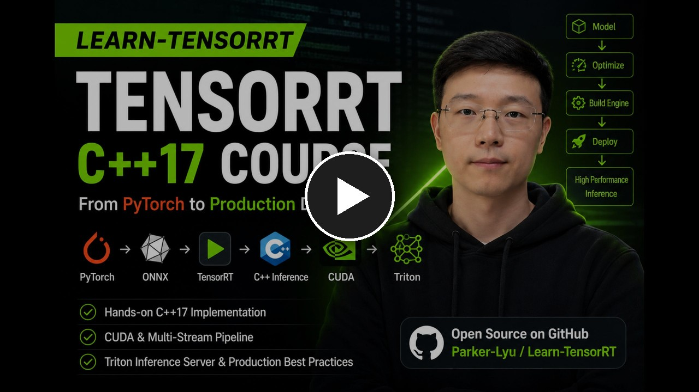

[English](../README.md) | [简体中文](README.zh-CN.md) | [日本語](README.ja.md) | [한국어](README.ko.md)

# Learn TensorRT: 프로덕션 지향 C++ 추론 및 최적화

[](https://en.cppreference.com/w/cpp/17)
[](https://developer.nvidia.com/tensorrt)
[](https://developer.nvidia.com/cuda-toolkit)
[](https://catalog.ngc.nvidia.com/orgs/nvidia/containers/pytorch)

**TensorRT 10.14 고성능 배포**와 **저지연 파이프라인 엔지니어링**에 초점을 맞춘 실습 중심의 C++17 과정입니다.
**YOLOv8, CUDA 전처리, INT8 양자화, 비동기 파이프라인, Triton, DeepStream 및 Nsight 프로파일링**을 다룹니다.

내보낸 모델에서 측정 가능한 추론 시스템까지, 완전한 YOLOv8 배포 파이프라인을 C++17로 구축합니다.
RAII 기반 소유권, 명시적인 리소스 수명, 타깃 기반 CMake, 방어적 검증, 재현 가능한 증거,
단일 실행 파일을 넘어 확장할 수 있는 구성 요소 등 시스템의 신뢰성을 높이는 엔지니어링 방식을 학습합니다.

성능에 중요한 경로를 처음부터 끝까지 따라갑니다. ONNX 그래프를 검사하고 복구하며, 동적 형상으로 TensorRT 엔진을 빌드하고,
CUDA와 NPP로 데이터를 효율적으로 이동하며, YOLOv8 후처리를 구현합니다. 그런 다음 명시적 Q/DQ INT8 양자화,
비동기 멀티스트림 스케줄링, Sanitizer 및 장시간 안정성 테스트, Nsight 프로파일링을 통해 시스템을 최적화하고 운영합니다.
고급 선택 과정에서는 플러그인, Triton, DeepStream, Jetson DLA, OpenVINO, Python 바인딩 및 LLM 추론을 다룹니다.
최종적으로 단순한 `trtexec` 명령이 아니라 실행 가능하고 측정 가능한 배포 결과물을 완성합니다.

## 🎬 프로젝트 개요

[](https://www.youtube.com/watch?v=K1spF7xL_0o)

[YouTube](https://www.youtube.com/watch?v=K1spF7xL_0o)에서 짧은 프로젝트 소개 영상을 보고,
과정의 범위, 배포 워크플로, PyTorch에서 프로덕션 TensorRT 추론으로 이어지는 엔지니어링 경로를 확인하세요.


## 대상 독자

이 저장소는 알고리즘 연구와 프로덕션 엔지니어링 사이의 간극을 메우려는 개발자를 위해 설계되었습니다.

* **배포 분야로 전환하는 알고리즘 엔지니어:** 딥러닝(PyTorch, ONNX)에 대한 탄탄한 지식이 있지만 프로덕션급 추론을 위한 C++/TensorRT를 익혀야 하는 분.
* **초급/중급 배포 엔지니어:** Python TensorRT API 또는 `trtexec`를 사용해 보았으며, 명시적 Q/DQ 양자화, CUDA 제로 카피, 멀티스트림 비동기 실행 및 Nsight 프로파일링으로 역량을 확장하려는 분.
* **프로덕션 포트폴리오를 만드는 엔지니어:** 시니어급 Edge CV 또는 고성능 AI 배포 직무를 목표로 하며, 실제 파이프라인 아키텍처를 보여 주는 참조 프로젝트가 필요한 분.

**선수 지식:** 이 과정은 상당한 수준의 C++ 엔지니어링을 다룹니다. ISO C++17과 CMake에 대한 기본 지식이 필요합니다.
Python만 사용해 온 개발자는 먼저 C++ 소유권, 동시성, CUDA 실행 및 빌드 시스템의 기초를 학습해야 합니다.


## 학습 로드맵

먼저 [`docs/learning_roadmap.md`](learning_roadmap.md)를 읽을 수 있습니다.
[`docs/coverage_matrix.md`](coverage_matrix.md)를 사용하면 핵심 및 선택 주제를 프로덕션 배포 기술과 연결할 수 있습니다.
또는 과정을 순서대로 진행해도 됩니다.


프로젝트는 작은 레슨 단위로 구성되어 있습니다. 각 레슨은 실행 가능한 결과물 하나와 학습 내용을 정리한 짧은 기록 하나를 만들어야 합니다.
공유 이미지와 기타 재사용 가능한 리소스는 루트의 `assets` 폴더에 있습니다.

## 사용 방법
이 과정은 Ubuntu에서 개발 및 테스트되었습니다. Windows 또는 WSL 환경에서도 동작할 수 있지만 참조 환경은 아니며 추가 문제 해결이 필요할 수 있습니다.

1. 사용 가능한 NVIDIA GPU가 있는 Ubuntu 머신에서 이 저장소를 복제합니다.

```bash
git clone git@github.com:Parker-Lyu/Learn-TensorRT.git
cd Learn-TensorRT
```

2. [`00_environment_check/README.md`](../00_environment_check/README.md)에 따라 버전이 고정된 개발 환경을 시작합니다.

3. 선택적으로 VS Code와 Dev Containers 확장을 설치한 뒤 실행 중인 컨테이너에 연결하고 마운트된 프로젝트 디렉터리를 엽니다.

4. 핵심 레슨을 순서대로 완료하고 각 체크포인트에서 보고서를 작성합니다. 그런 다음 모든 선택 과정을 번호순으로 완료하기보다,
목표로 하는 채용 공고에 맞춰 선택 과정을 고릅니다.

### 핵심 경로

| 단계 | 레슨 | 결과 |
| --- | --- | --- |
| 기초 | `00_environment_check`부터 `11_yolov8_trt_cpp`까지 | 엔드투엔드 YOLOv8n TensorRT C++ 추론 |
| 체크포인트 1 | `12_end_to_end_validation_report` | 재현 가능한 기능 및 아키텍처 증거 |
| 최적화 | `13_nsight_performance_diagnosis`, `14_yolov8_int8_quantization_engineering` | 프로파일링된 FP32/FP16/INT8 성능, 명시적 Q/DQ 양자화 및 배포 증거 |
| 체크포인트 2 | `15_precision_performance_report` | 지원 자료로 활용할 수 있는 정밀도 및 성능 보고서 |
| 파이프라인 | `16_cpp_producer_consumer`부터 `21_integrated_tensorrt_video_pipeline`까지 | CUDA/NPP 전처리 및 실제 TensorRT 실행과 통합된 제한형 비동기/멀티스트림 오케스트레이션 |
| 체크포인트 3 | `22_pipeline_performance_report` | 재현 가능한 부하, 지연 시간, 처리량, Sanitizer, 재시작 및 30분 장시간 안정성 테스트 보고서. 상태는 환경별로 생성됨 |


### 선택 트랙

레슨 `23`–`31`은 전체 과정에서 안정적인 식별자를 사용합니다. 번호는 모든 선택 과정을 숫자 순서대로 완료해야 한다는 뜻이 아닙니다.
아래의 트랙별 순서와 선수 조건을 따르세요. 레슨 `32`는 최종 종합 과정입니다.

| 트랙 | 레슨 | 권장 순서 및 선수 조건 |
| --- | --- | --- |
| 서버 추론 | `24_triton_inference_server`, `29_cpp_shared_library_python_binding` | 둘 다 레슨 17을 기반으로 하며 서로 독립적입니다. |
| Edge CV | `27_deepstream_gstreamer_multistream`, `28_jetson_orin_xavier_dla_deployment` | 가능하면 27을 먼저 학습한 후 28을 진행하세요. 28의 전체 검증에는 Jetson/DLA 하드웨어가 필요합니다. |
| 고급 TensorRT | `25_onnx_graph_surgery_plugin`, `26_custom_tensorrt_plugin` | **25 → 26**: 동일한 미지원 `com.acme::AcmeSwish` 모델을 먼저 GraphSurgeon으로, 다음에는 TensorRT 플러그인으로 복구합니다. |
| CPU 및 Intel | `23_openvino_yolov8` | 독립 경로입니다. 문서에 따라 레슨 05/15의 ONNX 및 비교 증거를 재사용합니다. |
| LLM 기초 이해 | `30_llm_inference_intro` | 독립 경로이며 YOLO/TensorRT 선택 과정을 선수 조건으로 요구하지 않습니다. |
| CUDA 커널 최적화 | `31_nsight_compute_kernel_analysis` | 레슨 13을 완료하고 레슨 26의 자체 커널 경계를 이해한 뒤, 소형 MLP를 프로파일링하고 LayerNorm을 최적화하며 연산자/네트워크/프로덕션 의사 결정을 내립니다. |
| 최종 종합 | `32_final_portfolio_case_study` | 핵심 체크포인트와 제시할 선택 과정의 증거를 완료한 후 진행합니다. |


## 학습 방법

각 레슨의 `README.md`에 따라 코드를 빌드하고 실행한 다음 출력을 확인합니다.

예상 출력을 얻는 것은 시작일 뿐입니다. AI를 학습 보조 도구로 활용하면서,
단순히 프로그램을 실행하는 데 그치지 말고 비판적인 관점으로 각 레슨의 코드를 살펴보고 구현을 이해하세요.

## 요구 사항

- 적절한 NVIDIA GPU를 갖추고 Docker와 NVIDIA 컨테이너를 실행할 수 있는 Ubuntu 호스트.


## 🚀 학습에서 취업까지

[](https://github.com/Parker-Lyu/Learn-TensorRT)

이 저장소가 고성능 AI 엔지니어링 분야에서 원하는 직무를 얻는 데 도움이 되기를 바랍니다. 즐겁게 코딩하세요!🎉

## 저자 소개

Parker Lyu — [LinkedIn](https://www.linkedin.com/in/parker-lyu-ai/)

## 라이선스

이 프로젝트는 [MIT License](../LICENSE)에 따라 라이선스가 부여됩니다.
